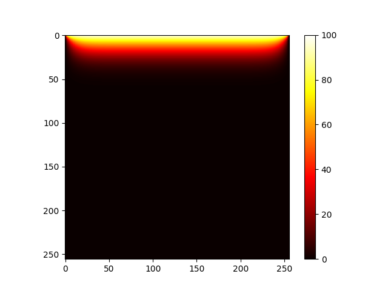

# Parallel 2D Heat Equation (C++ / MPI)

A distributed-memory solver for the 2D heat equation on a square grid, written in C++17 with MPI.
The top edge is held at 100, the other three edges at 0, and the interior evolves with an explicit
5-point stencil:

```
u_new[i][j] = u[i][j] + alpha * (u[i-1][j] + u[i+1][j] + u[i][j-1] + u[i][j+1] - 4*u[i][j])
```

with `alpha = 0.2` (the explicit scheme is stable for `alpha <= 0.25`).



## How it works

- **Row decomposition.** The `N x N` grid is split into horizontal strips of `N / P` rows, one per MPI process.
- **Ghost rows.** Each process stores its strip in a flat `std::vector<double>` of `(N/P + 2) * N` values.
  The two extra rows hold copies of the neighbours' edge rows.
- **Halo exchange.** Before every time step, neighbouring processes swap edge rows with two
  `MPI_Sendrecv` calls. The outermost processes talk to `MPI_PROC_NULL`, so no special cases are needed.
- **Double buffering.** Two grids (`u`, `uNew`) are swapped after every step.
- **Results.** The average temperature is computed with `MPI_Reduce` (sum), the run time is the slowest
  process (`MPI_Reduce` with `MPI_MAX`, measured with `MPI_Wtime` after a barrier), and for small grids
  (`N <= 1024`) the full grid is collected with `MPI_Gather` and written to `grid.csv` for plotting.

## Build and run

Requirements: a C++17 compiler, CMake >= 3.16 and an MPI implementation (e.g. `brew install open-mpi`).

```bash
cmake -S . -B build
cmake --build build

# usage: heat K N      (K = time steps, N = grid size)
mpirun -np 4 ./build/heat 1000 256

# or via the CMake target (defaults: NP=4, K=1000, N=256)
cmake --build build --target run
```

`N` must be divisible by the number of processes.

Plot the result (needs `numpy` and `matplotlib`):

```bash
python3 plot.py
```

Everything in one go (build, correctness checks, benchmark, writes `results.md`):

```bash
./run_all.sh
```

## Validation

The parallel version was checked against a single-process reference implementation:
for `N = 256`, `K = 1000` the average temperature is **6.01949**, and the program prints the same value
with 1, 2 and 4 processes.

## Performance

Strong scaling for `N = 4096`, `K = 200` (time of the slowest process):

| processes | time (s) | speedup | efficiency |
|---|---|---|---|
| 1 | 1.367 | 1.00 | 100% |
| 2 | 0.888 | 1.54 | 77% |
| 4 | 0.740 | 1.85 | 46% |
| 8 | 0.961 | 1.42 | 18% |

Speedup improves up to 4 processes and then gets worse at 8. The stencil does very little arithmetic per
byte loaded, so it is limited by memory bandwidth rather than compute, which caps the speedup well below
the process count. At 8 processes the run is likely also affected by more processes than physical cores
on the machine, and by halo-exchange overhead. Larger grids or a machine with more cores and memory
bandwidth would be needed to see better scaling.

## Possible next steps

- Handle `N` not divisible by the number of processes.
- Overlap communication and computation (non-blocking `MPI_Isend`/`MPI_Irecv` on the interior rows).
- 2D domain decomposition to reduce the amount of data exchanged per process.
- Add OpenMP inside each process (hybrid MPI + OpenMP).
