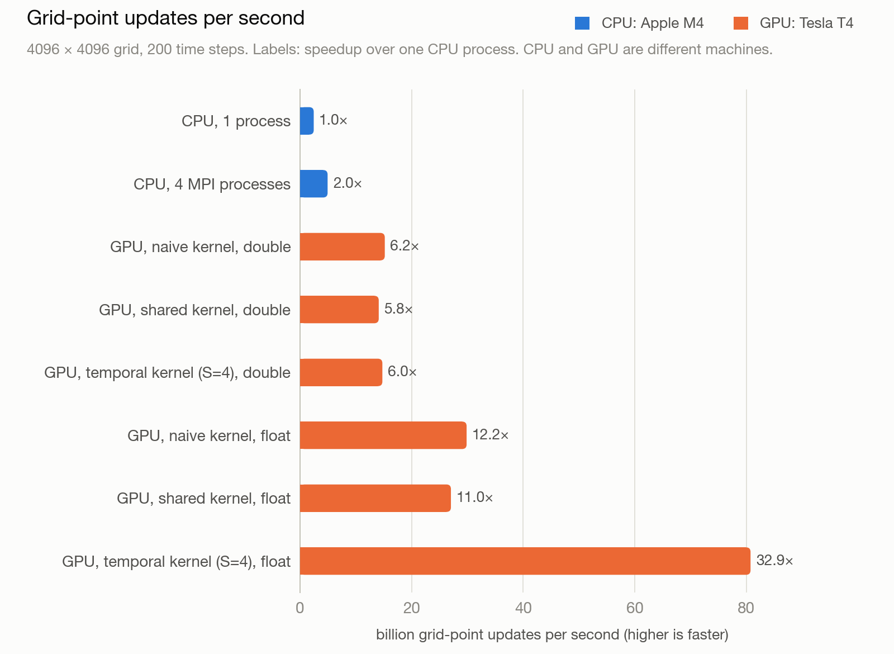

# Parallel 2D Heat Equation: MPI, CUDA and MPI + CUDA

[](https://github.com/nikoslaz/heat-equation-mpi/actions/workflows/ci.yml)
[](https://colab.research.google.com/github/nikoslaz/heat-equation-mpi/blob/main/colab/heat_cuda.ipynb)

[](LICENSE)


The 2D heat equation in C++17, in three versions built from one code base:

- **`heat`**: CPUs. The grid is split into row strips over MPI processes, and the halo exchange runs
  while the inner rows are computed.
- **`heat_cuda`**: one NVIDIA GPU, with three kernels, up to temporal blocking (several time steps
  per trip through GPU memory), in double or float precision.
- **`heat_mpi_cuda`**: several GPUs, one per MPI process, with two CUDA streams hiding the halo exchange.

Every program checks itself against a serial run (`--verify`). The CUDA code is tested on every commit on
machines without a GPU, through a small CPU emulator of CUDA that ships with the project.

The animation is the project's own CPU program at work: heat spreading from the top edge, held at 100,
into a plate whose other edges are held at 0.

<br clear="right">

## Results

<picture>
  <source media="(prefers-color-scheme: dark)" srcset="docs/images/performance-dark.png">
  
</picture>

On a 4096 × 4096 grid, a Tesla T4 on a free Google Colab runtime runs the temporal-blocking kernel in single
precision **32.9× faster than one process on an Apple M4** (16× faster than the best MPI run on it). The plain
kernels on the GPU, and the CPU from four processes on, are limited by memory bandwidth: the simplest kernel uses
76 % of the T4's bandwidth and still gets only 6.2×. Temporal blocking moves the grid through memory once per four
time steps instead of every step, which takes the float kernel to twice the speed the bandwidth would otherwise
allow. [Measurements and analysis](docs/performance.md), including why it does not help in double precision on a T4.

## Quick start

You need a C++17 compiler, CMake 3.22+ and MPI (`brew install open-mpi`, or `apt install libopenmpi-dev openmpi-bin`).

```bash
git clone https://github.com/nikoslaz/heat-equation-mpi.git
cd heat-equation-mpi
cmake --preset release
cmake --build --preset release -j
mpirun -np 4 build/release/heat 1000 256 --verify
```

```
Program   = heat (CPU, MPI)
Grid      = 256 x 256 grid, 1000 time steps
Setup     = 4 processes, non-blocking halo exchange overlapped with computation
Average   = 6.01949
Time      = 0.005296 s
Rate      = 12.3746 GLUP/s (billion grid-point updates per second)
Verify    = OK, largest difference from a serial run: 0 (grid), 5.13367e-13 (average); tolerance 1e-09
Output    = grid.csv
```

With the CUDA Toolkit installed, `cmake --preset cuda` also builds the GPU programs:

```bash
build/cuda/heat_cuda 1000 256 --kernel temporal --tsteps 4 --precision float --verify
mpirun -np 2 build/cuda/heat_mpi_cuda 1000 256 --verify
```

Each program prints its options with `--help`. `python3 scripts/plot_grid.py grid.csv` draws the final temperature.

**No NVIDIA GPU?** Click **Open in Colab** above: the notebook builds the project on a free GPU, runs the tests,
benchmarks every kernel and draws the charts. Or build the CUDA programs against the CPU emulator with
`cmake --preset emulator`. That is how CI tests them.

## How it works

The equation is solved with an explicit 5-point stencil, `u_new = u + 0.2 · (up + down + left + right − 4u)`.
Each update moves 16 bytes for about 7 floating-point operations, so every version is limited by memory bandwidth,
and each optimisation either moves fewer bytes or hides the time spent moving them:

| technique | where |
|---|---|
| Row decomposition with ghost rows, uneven strips allowed | `heat`, `heat_mpi_cuda` |
| Non-blocking halo exchange, computed while the inner rows are updated | `heat` (MPI), `heat_mpi_cuda` (two CUDA streams) |
| Shared-memory tiles with a halo | `heat_cuda --kernel shared` |
| Temporal blocking: S steps per launch, overlapping tiles recomputed | `heat_cuda --kernel temporal` |
| Single precision: half the bytes | `heat_cuda --precision float` |
| Two-level GPU reduction: warp shuffles, then shared memory | the average, in both GPU programs |
| CUDA-aware MPI: GPU memory passed straight to MPI | `heat_mpi_cuda --cuda-aware` |

[How it works](docs/how-it-works.md) explains each one with diagrams.

## Engineering

- **Tests:** GoogleTest unit tests, and runs of every program with `--verify` under MPI with 1 to 7 processes,
  uneven strips, one-row strips, every kernel and both precisions: 77 tests, run by CTest.
- **CUDA without a GPU:** [`tools/cuda_emulator`](tools/cuda_emulator) runs the kernels on CPU threads in shuffled
  block order, so CI tests the CUDA logic on every commit. Seven bugs planted in the kernels to test it were all
  caught.
- **CI:** GCC and Clang with warnings as errors, AddressSanitizer and UndefinedBehaviorSanitizer, `nvcc` builds for
  CUDA 12.9 and 13.0, clang-format and clang-tidy.
- **Code:** RAII for MPI and every GPU resource, errors reported with the failed call and its location, CMake presets,
  one command-line parser shared by the three programs.

[Development guide](docs/development.md): building, testing, sanitizers, formatting, CI, benchmarks.

## Repository layout

```
src/core/            shared code: problem, stencil, command line, output
src/mpi/             heat: the CPU program, and the MPI helpers
src/cuda/            the CUDA kernels, heat_cuda and heat_mpi_cuda
tests/               unit tests and program tests
tools/cuda_emulator/ CPU emulator of CUDA, for testing without a GPU
scripts/             benchmarks and figures
results/             measured results (CSV)
docs/                documentation and figures
colab/               the Google Colab notebook
```

## License

[MIT](LICENSE)
