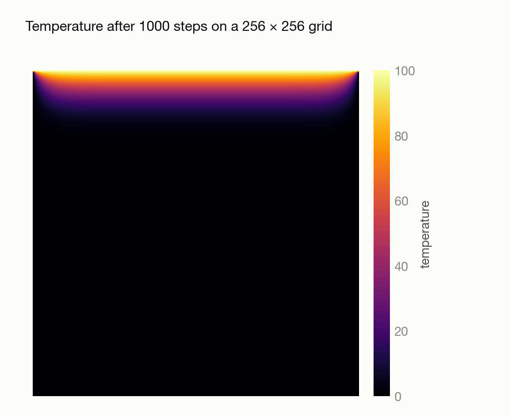

# How it works

## The problem

The programs solve the heat equation ∂u/∂t = D ∇²u on a square plate. The plate is an N × N grid, and time
advances with the explicit 5-point stencil

```
u_new[i][j] = u[i][j] + α · (u[i-1][j] + u[i+1][j] + u[i][j-1] + u[i][j+1] − 4·u[i][j])
```

with α = D·Δt/Δx² = 0.2. The scheme is stable for α ≤ 0.25. With α = 0.2 every new value is a weighted average of
five old ones, so the temperature always stays between the boundary values (a unit test checks this).

- **Boundary:** the top edge is held at 100, the other three edges at 0.
- **Initial condition:** the top row at 100, everything else 0.
- **Reference result:** on a 256 × 256 grid after 1000 steps the average temperature is **6.01949**. Every program
  reproduces it, with any number of processes, and the tests check it.

<picture>
  <source media="(prefers-color-scheme: dark)" srcset="images/heat-dark.png">
  
</picture>

**Why speed is about memory.** Each update reads one new value from memory and writes one (the neighbours are
usually still in a cache): 16 bytes in double precision, for about 7 floating-point operations. Any CPU or GPU can
do arithmetic far faster than it can move data at that ratio, so the stencil is limited by memory bandwidth. Every
optimisation below is a way to move fewer bytes, or to hide the time spent moving them.

## The CPU program: `heat`


- **Row strips.** The N rows are split over P MPI processes as evenly as possible: the first N mod P processes get
  one row more (`strip_of` in [`src/core/problem.hpp`](../src/core/problem.hpp)). Any N ≥ P works.
- **Ghost rows.** Each process stores its strip with one extra row above and one below, filled with copies of the
  neighbours' edge rows. The global boundary rows are never updated; `updated_rows` works out which local rows are
  interior.
- **Halo exchange, overlapped.** Each step starts a non-blocking exchange (two `MPI_Irecv`, two `MPI_Isend`),
  computes the inner rows, which need no ghost rows, while the messages travel, then waits and computes the two edge
  rows. `--no-overlap` uses blocking `MPI_Sendrecv` first instead, for comparison. At the top and bottom of the grid
  the neighbour is `MPI_PROC_NULL`, so no special case is needed.
- **Double buffering.** Two copies of the strip; each step reads one and writes the other, then they swap.
- **Results.** The average is an `MPI_Reduce` sum, the time is the slowest process's (`MPI_Reduce` with `MPI_MAX`
  after a barrier), and for `--verify` or `grid.csv` the strips are collected on rank 0 with `MPI_Gatherv`.

The code is in [`src/mpi/solver.cpp`](../src/mpi/solver.cpp); MPI errors are reported with the failed call and its
location by `CHECK_MPI`, and `mpi::Session` initialises and finalises MPI.

## One GPU: `heat_cuda`

The grid lives in GPU memory as two buffers that swap every step. It is copied to the GPU once and back once, and
the time-step loop is timed with CUDA events after one untimed warm-up step (the first launch of a kernel also
loads it). GPU memory, pinned host memory, streams and events are wrapped in small RAII classes
([`src/cuda/cuda_utils.hpp`](../src/cuda/cuda_utils.hpp)), so they are released on every path out of a function.
There are three kernels ([`src/cuda/kernels.cu`](../src/cuda/kernels.cu)):

| `--kernel` | how a time step is computed | grid traffic to GPU memory |
|---|---|---|
| `naive` | one thread per point, in 32 × 8 blocks; neighbours come from the L1/L2 caches | once per step |
| `shared` | each block first copies its tile plus a one-point halo into shared memory | once per step |
| `temporal` | each block keeps its tile in shared memory for S steps (`--tsteps S`, 1–8) | once per S steps |


**Temporal blocking.** A block of 64 × 8 threads loads a 32 × 64 tile into shared memory, four rows per thread,
and advances it S steps there, reading one copy of the tile and writing a second one each step. After s steps only
the points at least s away from the tile edge are still exact, because the edge has no neighbours inside the tile,
so the block writes back the inner (32 − 2S) × (64 − 2S) points. Neighbouring tiles overlap by 2S rows and columns
and their written parts meet exactly. The overlap is computed twice, but the grid crosses the memory bus once per
S steps instead of every step, and for a memory-bound stencil that is the trade worth making.

**Precision.** `--precision float` halves the bytes per value; `--verify` allows for float rounding (tolerance
1e-2 instead of 1e-9).

**The average** is computed on the GPU: each thread sums a strided part of the grid, each warp combines its 32 sums
with `__shfl_down_sync`, the warps of a block combine theirs through shared memory, and the host adds the block
sums in a fixed order, so the result is the same every run.

## Several GPUs: `heat_mpi_cuda`

The same row strips and ghost rows, but each process keeps its strip in the memory of its own GPU: processes on a
node are numbered with `MPI_Comm_split_type` and take GPUs round-robin.


Each step uses two CUDA streams. The inner rows start on one; on the other, the edge rows are copied into pinned
host memory, exchanged with `MPI_Sendrecv` and copied back into the ghost rows, and then the two edge rows are
updated. The step ends when both streams are done. `--no-overlap` does it all in sequence, and `--cuda-aware` hands
GPU pointers straight to MPI, skipping the copies through host memory (this needs an MPI built with CUDA support).

## Checking the results

Every program has `--verify`. It runs the same problem serially on the CPU
([`src/core/stencil.hpp`](../src/core/stencil.hpp)), compares every grid point and the average, prints the largest
differences and exits with 1 if either is above the tolerance. Results from the GPU differ from the serial run only
by rounding: GPUs fuse multiply-adds, which changes the last bits (about 1e-14 here), and float runs differ by about
1e-5. The tests ([`tests/CMakeLists.txt`](../tests/CMakeLists.txt)) run every program this way, with uneven strips,
strips of a single row, and grid sizes that are not multiples of any tile size.

## Code map

| file | what it holds |
|---|---|
| [`src/core/problem.hpp`](../src/core/problem.hpp) | the constants, the initial condition, the row decomposition |
| [`src/core/stencil.hpp`](../src/core/stencil.hpp) | the stencil on the CPU and the serial solver |
| [`src/core/cli.hpp`](../src/core/cli.hpp) | the command-line parser all programs share |
| [`src/core/report.hpp`](../src/core/report.hpp) | the printed output, `grid.csv`, the check against the serial solver |
| [`src/mpi/mpi_utils.hpp`](../src/mpi/mpi_utils.hpp) | `CHECK_MPI`, `mpi::Session`, neighbours, gathering the grid |
| [`src/mpi/solver.cpp`](../src/mpi/solver.cpp), [`main.cpp`](../src/mpi/main.cpp) | the CPU program |
| [`src/cuda/kernels.cu`](../src/cuda/kernels.cu) | the CUDA kernels and their launchers, behind [`kernels.hpp`](../src/cuda/kernels.hpp) |
| [`src/cuda/cuda_utils.hpp`](../src/cuda/cuda_utils.hpp) | `CHECK_CUDA` and the RAII wrappers |
| [`src/cuda/heat_cuda.cpp`](../src/cuda/heat_cuda.cpp) | the single-GPU program |
| [`src/cuda/heat_mpi_cuda.cpp`](../src/cuda/heat_mpi_cuda.cpp) | the multi-GPU program |
| [`tools/cuda_emulator/`](../tools/cuda_emulator) | the CPU emulator of CUDA used for testing without a GPU |
