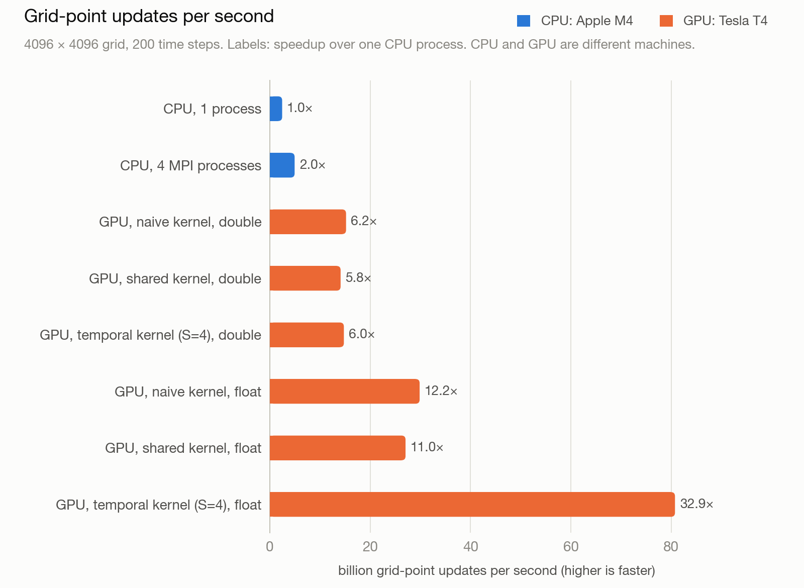
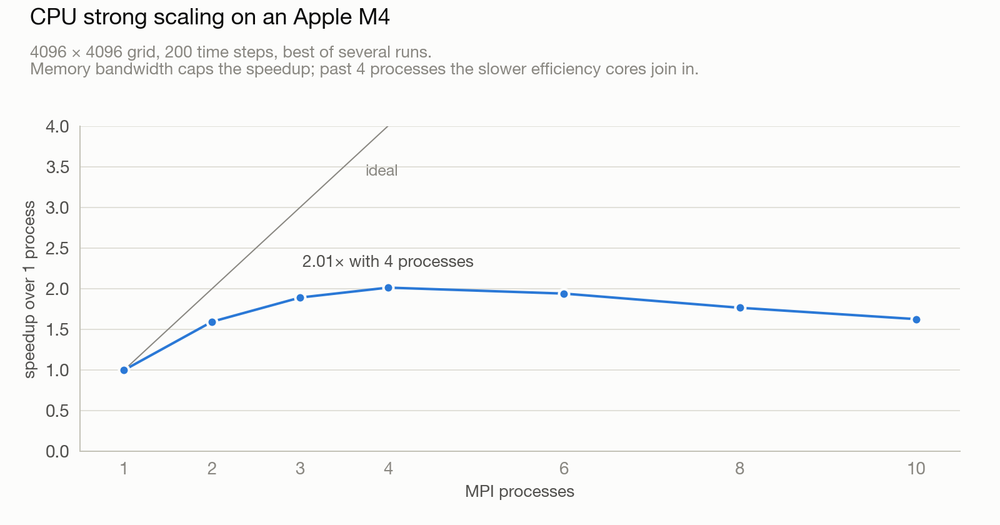
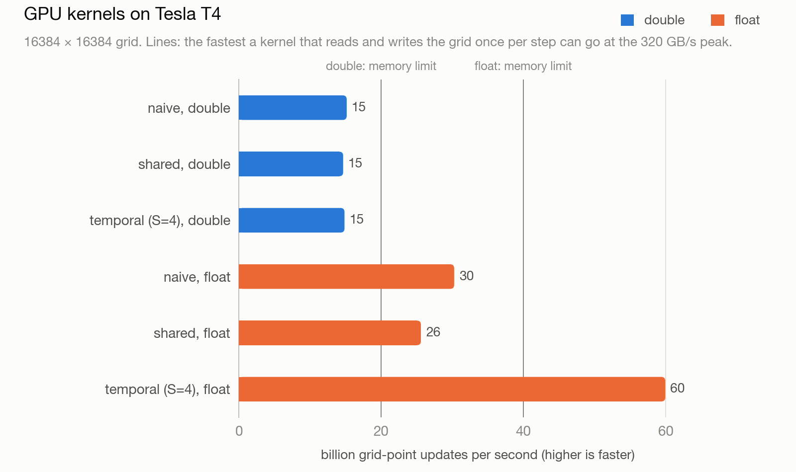

# Performance

All measurements are in [`results/`](../results) as CSV files and the charts are drawn from them by
[`scripts/make_charts.py`](../scripts/make_charts.py). The benchmark problem is a 4096 × 4096 grid and 200 time
steps; speed is given in GLUP/s, billions of grid-point updates per second.

| | machine | software |
|---|---|---|
| CPU | Apple M4: 4 performance and 6 efficiency cores, 120 GB/s memory bandwidth (Apple's figure) | macOS 15, Apple Clang 17, Open MPI 5.0 |
| GPU | NVIDIA Tesla T4 on Google Colab: 320 GB/s memory bandwidth, 8.1 TFLOP/s in float, 1/32 of that in double | CUDA 13.0 |

The CPU and the GPU are different machines, so the CPU-to-GPU ratios compare these two machines, not CPUs and
GPUs in general.

<picture>
  <source media="(prefers-color-scheme: dark)" srcset="images/performance-dark.png">
  
</picture>

## CPU: `heat` on an Apple M4

<picture>
  <source media="(prefers-color-scheme: dark)" srcset="images/mpi-scaling-dark.png">
  
</picture>

Best of five runs ([`results/cpu-apple-m4.csv`](../results/cpu-apple-m4.csv), `scripts/bench_mpi.sh`):

| processes | time (s), overlapped exchange | time (s), blocking exchange | GLUP/s (best) | speedup |
|---|---|---|---|---|
| 1 | 1.444 | 1.368 | 2.45 | 1.00 |
| 2 | 0.889 | 0.858 | 3.91 | 1.60 |
| 3 | 0.723 | 0.726 | 4.64 | 1.89 |
| 4 | **0.679** | 0.690 | **4.94** | **2.01** |
| 6 | 0.705 | 0.724 | 4.76 | 1.94 |
| 8 | 0.775 | 0.793 | 4.33 | 1.77 |
| 10 | 0.841 | 0.859 | 3.99 | 1.63 |

Speedups are relative to the fastest one-process run. With one process the two exchange modes run the same code,
so their difference (1.444 s against 1.368 s) shows the run-to-run noise on this laptop, about 5 %.

- **Memory bandwidth sets the limit.** At its best, 4.94 GLUP/s, the program moves at least 16 bytes per update
  (one value read, one written): 79 GB/s, about two thirds of the M4's 120 GB/s. Adding processes adds arithmetic,
  not bandwidth, so the speedup flattens at about 2×.
- **Past four processes it gets slower.** The M4 has four performance cores. Further processes run on the slower
  efficiency cores, and since every process waits for its neighbours each step, the slowest one sets the pace.
- **Overlapping the exchange makes no measurable difference here.** On one machine MPI messages are memory copies
  of a single 32 KB row, which take far less time than computing a strip. The overlap matters when messages cross
  a network; the code is the same either way.

## GPU: `heat_cuda` on a Tesla T4

<picture>
  <source media="(prefers-color-scheme: dark)" srcset="images/gpu-kernels-dark.png">
  
</picture>

Measured with [the Colab notebook](../colab/heat_cuda.ipynb) ([`results/gpu-tesla-t4.csv`](../results/gpu-tesla-t4.csv),
`scripts/bench_cuda.sh`), 200 time steps. GLUP/s, with the speedup over the naive kernel in brackets:

| N | precision | naive | shared | temporal (S = 4) |
|---|---|---|---|---|
| 4096 | double | 15.2 | 14.1 (0.93×) | 14.8 (0.97×) |
| 4096 | float | 29.9 | 27.1 (0.91×) | **80.8 (2.70×)** |
| 8192 | double | 15.1 | 14.6 (0.97×) | 14.9 (0.99×) |
| 8192 | float | 30.3 | 26.6 (0.88×) | **65.2 (2.15×)** |
| 16384 | double | 15.2 | 14.7 (0.97×) | 14.9 (0.98×) |
| 16384 | float | 30.3 | 25.6 (0.85×) | **59.9 (1.98×)** |

The temporal kernel with S = 1 to 8 time steps per launch, N = 8192:

| S | 1 | 2 | 3 | 4 | 5 | 6 | 7 | 8 |
|---|---|---|---|---|---|---|---|---|
| double, GLUP/s | 13.2 | **16.5** | 15.6 | 14.7 | 13.1 | 11.4 | 10.1 | 8.5 |
| float, GLUP/s | 26.9 | 50.9 | 58.3 | **60.7** | 56.9 | 52.9 | 47.3 | 43.4 |

- **The naive kernel runs at the memory limit.** Reading and writing each value once per step takes 16 bytes per
  update in double and 8 in float, so at the T4's 320 GB/s no such kernel can pass 20 GLUP/s in double or 40 in
  float. The naive kernel reaches 15 and 30: 76 % of the memory bandwidth in both precisions.
- **Shared-memory tiles are slower than the caches.** Copying a tile and its halo into shared memory costs a
  barrier and extra loads, and saves nothing, because the L1 and L2 caches already serve the neighbours' values.
  The shared kernel is 3–15 % slower everywhere.
- **Temporal blocking breaks the memory limit in float.** It moves the grid once per S steps, so its effective
  bandwidth, the traffic a one-step kernel would need for the same rate, reaches 646 GB/s at N = 4096: twice the
  T4's peak. The best S is 4. Smaller S saves less traffic; larger S shrinks the part of each tile that is written
  back (with S = 8 it is (32 − 16) × (64 − 16) of 32 × 64 points, 38 %), so more work is recomputed in the overlaps.
  It is fastest at the smallest grid, 80.8 against about 60 GLUP/s; a profiler would show why.
- **In double precision it barely helps** (at best 16.5 against 15.1 GLUP/s, with S = 2). The T4 does
  double-precision arithmetic at 1/32 of its single-precision rate, so once less data moves, the kernel runs out of
  arithmetic instead, and recomputing the tile overlaps makes that worse as S grows. On a data-centre GPU with
  full-rate double precision (A100, H100) the picture would be different.
- **Against the CPU** (different machines): the naive kernel in double is 6.2× faster than one M4 process and 3.1×
  faster than the best MPI run; the temporal kernel in float is 32.9× and 16.4× faster.

### MPI + CUDA on one GPU

`heat_mpi_cuda` with N = 8192 in double precision, naive kernel:

| processes | overlapped exchange (s) | blocking exchange (s) | GLUP/s (best) |
|---|---|---|---|
| 1 | 0.885 | 0.885 | 15.2 |
| 2 | 1.049 | 1.041 | 12.9 |
| 4 | 1.067 | 1.052 | 12.8 |

Colab has one GPU, so here the processes share it: the extra processes only add the halo exchange and the switching
between them, and the program is about 15 % slower than with one process. This measures the overhead, not
multi-GPU scaling, which needs a machine with several GPUs.

## Reproducing

```bash
scripts/bench_mpi.sh build/release   # CPU, writes results/cpu-<machine>.csv
scripts/bench_cuda.sh build/cuda     # GPU, writes results/gpu-<device>.csv
python3 scripts/make_charts.py       # redraws the charts in docs/images
```

For stable CPU numbers, close other applications and let the machine cool down after builds: the scripts report
the best of several runs, but a laptop that is already hot runs slower.
